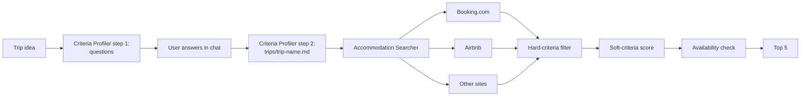

# Vacation Finder

Two Claude Code agent prompts that find holiday rentals. The first one interviews the traveller and writes a trip profile with hard and soft criteria. The second searches Booking.com, Airbnb and the open web, filters on the hard criteria, scores the rest on the soft ones and returns a Top 5 with booking links.

The prompts and the agents' output are in German.

## How it works

A router file ([`AGENT.md`](AGENT.md)) runs the two agents in sequence. Each agent is a Markdown prompt in [`agents/`](agents/). The main Claude Code session runs the Criteria Profiler itself, because the profiler asks the user questions and waits for the answers in chat. The Accommodation Searcher runs as a spawned subagent, and the main session passes its output to the user unchanged.



| Agent | Input | Output | Runs unattended |
|---|---|---|---|
| [Criteria Profiler](agents/criteria-profiler.md) | Whatever the user has said about the trip | Step 1: up to 6 questions on dates, destination, group, budget, must-haves and purpose. Step 2: a trip profile in `trips/` | No, waits for the user's answers between the two steps |
| [Accommodation Searcher](agents/accommodation-searcher.md) | A trip profile | Search log, Top 5 listings with price, rating, score and availability status, one recommendation | Yes, once a trip profile exists |

## Design decisions

- **Hard criteria filter, soft criteria rank.** Budget cap and minimum sleeping capacity are always hard. Anything the user calls a must-have becomes hard as well, and a listing that misses one is dropped. Soft criteria carry a weight of high, medium or low.
- **Explicit scoring rule.** A met soft criterion adds 3, 2 or 1 points by weight. A rating of 4.5/5 or higher adds 2, good location reviews add 1. The score is printed per listing so the ranking can be checked.
- **Availability is checked per listing.** Each candidate's listing page is fetched with the trip dates. The result is one of confirmed (✅), unavailable (dropped) or not checkable (⚠️, with a note to ask the host).
- **Unverified data is labelled.** A price, rating or feature taken only from a search snippet is marked as unverified. A hard criterion that cannot be checked keeps the listing in the list with a ⚠️, ranked behind fully checked listings.
- **Questions are skipped when already answered.** The profiler extracts dates, destination and group from the first message and only asks about what is missing. If it is unclear whether a wish is hard or soft, it asks before saving.
- **Personal data stays local.** Trip profiles in `trips/` are git-ignored by the `.gitignore` in this folder. A fresh clone has no `trips/` folder; the profiler creates it on first save.

## Setup

Requirements: [Claude Code](https://docs.claude.com/en/docs/claude-code) with web search and web fetch enabled. No API keys or MCP servers are needed.

Steps:

1. Clone the repository and start Claude Code inside the cloned folder:
   ```sh
   git clone <repo-url> pensionfinder
   cd pensionfinder
   claude
   ```
   The `CLAUDE.md` in this folder points Claude Code to the router. All paths in the prompts are relative to this folder.
2. Start in German, for example `Ich suche eine Ferienwohnung für 2 Personen im Allgäu, 3 Nächte im Juli`.
3. To search again with an existing profile, name its file without `.md`, for example `Unterkünfte suchen für allgaeu-juli-2026`.

Using the folder inside a larger workspace: if you start Claude Code in a parent directory, add one line to that directory's `CLAUDE.md`:

```markdown
For holiday rental searches, read pensionfinder/AGENT.md first.
```

In this repository the root `CLAUDE.md` already contains this route.

## Limitations

- Airbnb and large parts of Booking.com render with JavaScript or answer a plain fetch with HTTP 403, so the fetch often returns no prices or calendar. The searcher then falls back to web search results, and many listings end up with availability ⚠️ and unverified prices.
- Prices and availability reflect the moment of the search and change quickly in peak season.
- The agent does not book or contact hosts.
- A full run costs real money. One complete run of profiler and searcher took about 7 minutes, 3.01 USD and 65 tool calls (measured once with Claude Opus via `claude -p`).
- If fewer than five listings pass the hard criteria, the searcher returns only those and proposes which criterion to relax.
- There is no automated test suite; output quality was checked by reading real runs.

## License

[MIT](LICENSE)
