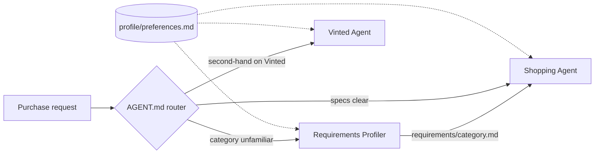

# Shopping Helper

A set of Claude Code subagents that turn a purchase idea into a short, ranked list of products. Every candidate is checked against a personal profile of body measurements, budget rules, preferred brands and deal-breakers before it is recommended.

The prompts and the agents' output are in German.

## How it works

A router file ([`AGENT.md`](AGENT.md)) decides which subagent handles a request. Each subagent is a Markdown prompt in [`agents/`](agents/) that the main Claude Code session hands to a spawned agent.



| Agent | Input | Output | Runs unattended |
|---|---|---|---|
| [Requirements Profiler](agents/requirements-profiler.md) | Product category, optional budget | Step 1: 4 to 6 use-case questions. Step 2: open decisions with pros and cons if any remain, then a requirements file with Must / Should / Nice-to-have / Deal-breaker | No, waits for the user's answers after step 1 and after open decisions |
| [Shopping Agent](agents/shopping-agent.md) | Purchase request, requirements file if one exists | Market overview, 3 to 5 products with current prices (geizhals.de product pages, other sources as fallback) and buy links, one recommendation | Yes |
| [Vinted Agent](agents/vinted-agent.md) | Search request for second-hand items | Search log, then a Top 5 of Vinted listings with size check and seller rating | Yes |

## Design decisions

- **Hard and soft constraints are separate steps.** The Vinted Agent drops any listing that breaks a hard constraint (budget, size, required spec) before ranking. Soft constraints only order what is left.
- **Two-pass size check.** Listings are first filtered on the size field, then re-checked against the user's measurements after the full description is fetched. A listing whose fit stays unclear is marked as uncertain and kept, so the user can judge the risk.
- **The profiler does not decide for the user.** When an answer leaves a choice open, the Requirements Profiler lists the options with pros and cons and saves the requirements file only after the user has picked.
- **Search log before results.** The Vinted Agent prints its search terms and hit counts before the Top 5, together with the reasons candidates were dropped, so a recommendation can be traced. The Shopping Agent opens with a market overview instead.
- **Personal data stays local.** The folder's own [`.gitignore`](.gitignore) excludes `profile/preferences.md` and `requirements/`, so this also holds when the folder is its own repository. [`profile/preferences.example.md`](profile/preferences.example.md) is the template.

## Setup

Requirements:

- [Claude Code](https://docs.claude.com/en/docs/claude-code) with web search and web fetch enabled.
- For the Vinted Agent only: the MCP server [andrijdavid/vinted-mcp](https://github.com/andrijdavid/vinted-mcp) (npm package `@andrijdavid/vinted-mcp`, Node.js required). The agent calls its tools `search_items`, `get_item` and `get_seller` under the server name `vinted-mcp`. That project's README registers the server as `vinted`, so register it under the other name:
  ```sh
  claude mcp add vinted-mcp -- npx -y @andrijdavid/vinted-mcp
  ```
  If you keep the name `vinted`, replace `mcp__vinted-mcp__` with `mcp__vinted__` in `AGENT.md` and `agents/vinted-agent.md`.

Steps:

1. Clone this repository and change into its folder. All paths in the prompts are relative to this folder.
2. Copy the profile template and fill it in:
   ```sh
   cp profile/preferences.example.md profile/preferences.md
   ```
3. Start Claude Code in this folder. The folder's [`CLAUDE.md`](CLAUDE.md) tells the session to read the router first.
4. Ask in German, for example `Ich will einen Wanderrucksack kaufen, Budget 150 €` or `Schau auf Vinted nach einer Regenjacke`.

In this repository the domain lives in the subfolder `shoppinghelper/`. Start Claude Code from the repository root, whose `CLAUDE.md` links `shoppinghelper/AGENT.md`, and run the copy command as `cp shoppinghelper/profile/preferences.example.md shoppinghelper/profile/preferences.md`.

## Limitations

- Prices and stock reflect the moment of the search. Links to geizhals.de or shops can go stale within days.
- geizhals.de covers shops in Germany and Austria. Outside that market, the Shopping Agent falls back to direct shop links.
- Without the Vinted MCP server only the Requirements Profiler and the Shopping Agent work. The router then offers the Shopping Agent instead.
- The geizhals.de search page (`geizhals.de/?fs=...`) returned HTTP 403 to WebFetch in every test run. The Shopping Agent finds product pages via web search instead and names any other price source it had to use.
- Runs cost money. In a test with Claude Opus via `claude -p`, one run cost 2.03 to 3.42 USD according to `total_cost_usd`.
- The ranking is the model's judgment against the profile. There is no deterministic scoring and no automated test suite; output quality was checked by reading real runs.

## License

[MIT](LICENSE)
