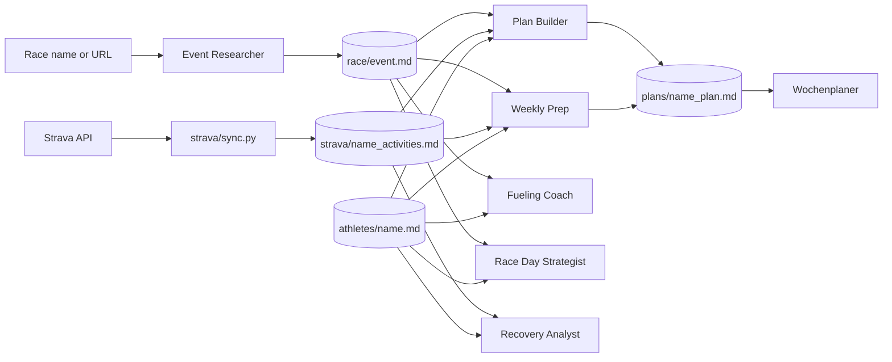

# Trainingsplanner

A set of Claude Code subagents that coach one or more athletes towards a trail ultra. They research the target race, build periodised training plans from Strava data, and turn weekly goals into a day-by-day schedule. Fueling, recovery and race-day strategy are covered as well. Everything personal lives in local profile files, so the agents themselves contain no athlete data.

The prompts and the agents' output are in German.

## How it works

A router file ([`AGENT.md`](AGENT.md)) decides which subagent handles a request. Each subagent is a Markdown prompt in [`agents/`](agents/) that the main Claude Code session hands to a spawned agent. All subagents read the same three kinds of local files: one profile per athlete, one race file, and the Strava export per athlete.



| Agent | Input | Output | Runs unattended |
|---|---|---|---|
| [Event Researcher](agents/event-researcher.md) | Race name and distance, or the official race URL | `race/event.md` filled from [the template](race/event.example.md): key data, course sections, aid stations and cutoffs, mandatory gear, training implications, open points, sources | Yes |
| [Plan Builder](agents/plan-builder.md) | Profiles, race file, Strava data, existing plans | One plan per athlete with weekly session goals and a 4-week outlook | Yes |
| [Weekly Prep](agents/weekly-prep.md) | Fresh Strava sync, profiles, plans, training log | Updated fitness section per profile, review of last week, load check, next week's plan, log entry | No, stops on activity gaps of 5+ days and for a subjective check-in |
| [Wochenplaner](agents/week-planner.md) | Weekly goals and the user's appointments | Day-by-day schedule with a reason per session | Yes, if the appointments are in the request |
| [Fueling Coach](agents/fueling.md) | Profile, race file, a session or race question | Timed fueling plan in grams and products, respecting dietary exclusions | Yes |
| [Recovery Analyst](agents/recovery.md) | Profile and Strava data | Status 🟢 / 🟡 / 🔴 with concrete measures and advice for the next session | Yes |
| [Race Day Strategist](agents/race-strategy.md) | Race file and profiles | Pacing per course section with cutoff buffer, fueling per aid station, gear checklist | Yes |

## Design decisions

- **Profiles hold everything personal.** Body data, diet, injury history, easy pace or heart rate, maximum running days, extra sessions (e.g. calf strength) and check-in rules sit in `athletes/[name].md`. A rule in a profile overrides the general rule in the agents, for example a stricter weekly volume cap.
- **Training partners are planned together.** If two profiles name each other as partners, their plans share all sessions except individual extras, and the joint pace follows the slower athlete.
- **Race data needs a source.** The Event Researcher writes no number without a source. Anything not yet published goes under "Offene Punkte" with a note on when it usually appears, and figures from a previous year are marked as such. Running it again later fills those gaps without touching the rest.
- **Plans set weekly goals.** The Plan Builder and Weekly Prep define which sessions happen in a week and leave the days open. The Wochenplaner places them around the user's real appointments, following hard rules such as no two hard running days in a row.
- **Load is a simple proxy.** Weekly Prep scores each activity as `run km + run Hm / 100 + bike km × 0.25` and compares the 7-day sum with the 28-day weekly average. The ratio, combined with a 1 to 5 self-rating, decides whether next week's volume rises, holds or drops.
- **Personal data stays local.** `athletes/`, `plans/`, `logs/`, `race/event*.md`, the Strava exports and `strava/.env` are git-ignored by [`.gitignore`](.gitignore) in this folder, which also applies when the folder is used as a repository of its own. [`athlete.example.md`](athlete.example.md) and [`race/event.example.md`](race/event.example.md) are the templates.

## Setup

Requirements:

- [Claude Code](https://docs.claude.com/en/docs/claude-code) with web search and web fetch enabled.
- For the Strava sync: Python 3 with `requests` and, per athlete, a Strava account with a paid subscription (Strava Premium). The sync currently only works with premium accounts.

Steps (all commands run inside the cloned folder):

1. Clone this repository and open Claude Code in the cloned folder. The [`CLAUDE.md`](CLAUDE.md) there points Claude Code to the router, and all paths in the prompts are relative to this folder.
2. Create one profile per athlete. The file name (lower case) is the athlete's name everywhere else:
   ```sh
   mkdir -p athletes && cp athlete.example.md athletes/alex.md
   ```
3. Connect Strava for each athlete:
   1. Create an API application at <https://www.strava.com/settings/api> with `localhost` as Authorization Callback Domain.
   2. Install the dependency in a virtual environment. A plain `pip install` fails on Homebrew Python with `externally-managed-environment` (PEP 668).
      ```sh
      python3 -m venv .venv && .venv/bin/pip install -r strava/requirements.txt
      ```
   3. Run `cp strava/.env.example strava/.env` and enter client ID and secret with the athlete's name as prefix (`ALEX_CLIENT_ID`, `ALEX_CLIENT_SECRET`).
   4. Run `.venv/bin/python strava/sync.py --setup-alex`. A browser window asks for access, and the script also prints the URL in case no browser opens. The callback waits 300 s. The refresh token is written back to `.env`; comments and order in that file stay as they are.
   5. Afterwards `.venv/bin/python strava/sync.py` syncs the last 120 days for every athlete in `.env`. If Strava rejects a stored token, the script stops and names the `--setup-<name>` command to reconnect.
4. Start in German, for example `Neues Rennen: Zugspitz Ultratrail Basetrail XL`, then `Plan anpassen` and once a week `Wochenvorbereitung`.

Used as a subfolder of a larger workspace (as in this repository): run the commands above inside `trainingsplanner/` and add one line to the workspace `CLAUDE.md` so Claude Code finds the router:

```markdown
For training questions, read trainingsplanner/AGENT.md first.
```

Optional: [`claude-project/`](claude-project/) contains instructions and a coaching guide for a claude.ai project. Weekly Prep writes a short version of each profile and plan to `claude-project/[name].md` for upload.

## Limitations

- The Strava sync only works with Strava Premium accounts. Without it, the agents still run but have no activity data, so Weekly Prep and the Recovery Analyst have nothing to analyse.
- The OAuth callback listens on `localhost:8282`, which has to be free during `--setup-<name>`.
- The periodisation uses a 19-week block as reference and scales it proportionally for other lead times. Very short lead times (under 8 weeks) are not handled specially.
- The load ratio is a rough proxy and does not use heart rate or power.
- The agents plan towards one target race. Once its date has passed, start the Event Researcher with the next race; the router asks for it.
- Race data is only as current as the last Event Researcher run; cutoffs and aid stations are often published a few months before the race.
- The agents are written for trail ultras with significant elevation. For road races, much of the advice (vert sessions, power hiking) does not apply.
- Every subagent run is a full model session and costs money. One Plan Builder run cost 1.55 USD and took 346 s, measured with Claude Opus via `claude -p`. Weekly Prep and the Event Researcher were not measured.
- There is no automated test suite.

## License

[MIT](LICENSE)
